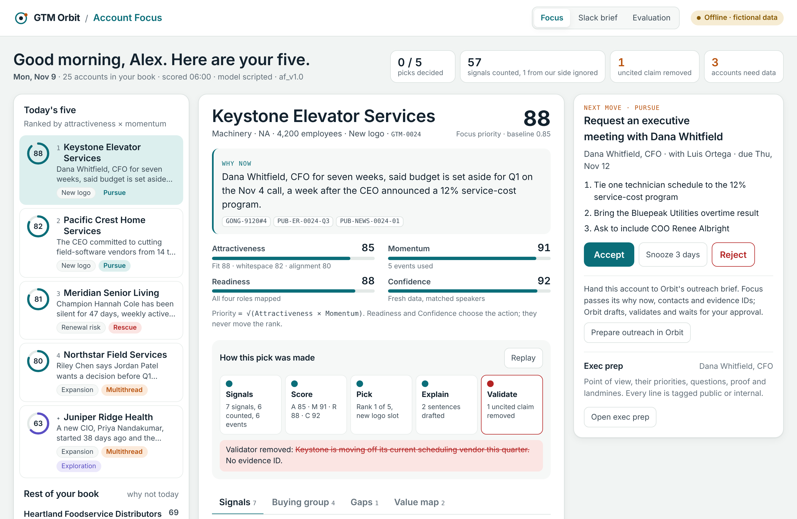
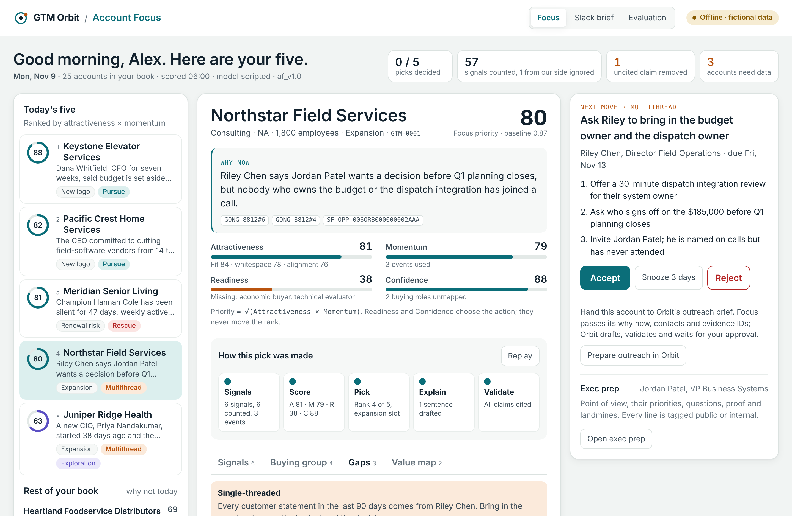
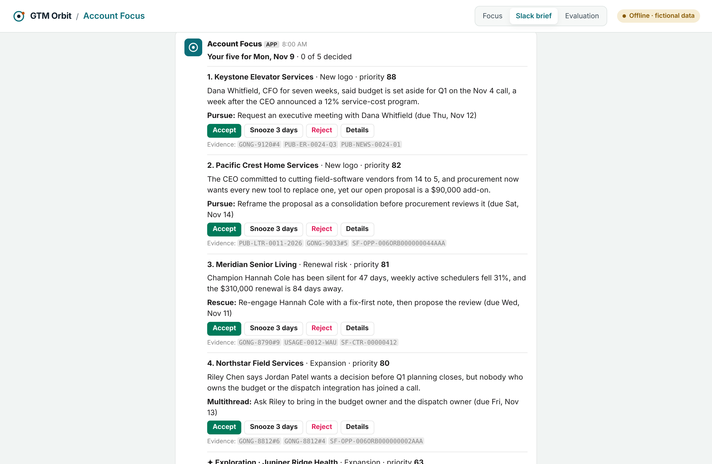
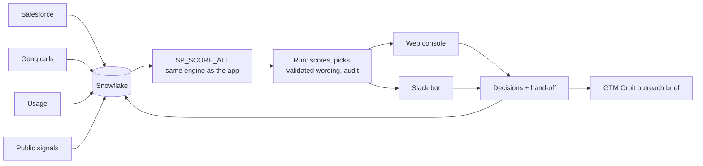

# Account Focus

**Five accounts a day, why now, and the next move.** Part of [GTM Orbit](https://github.com/hithakishore-all/gtm-orbit).

Account Focus is the daily decision layer inside GTM Orbit. Orbit keeps the customer, the seller and the company's go-to-market strategy connected as account conditions change. Account Focus puts that context to work each morning: it brings forward the five account-and-motion combinations most worth a seller's attention, explains why now, names who to engage, and recommends what to say and do next. Every recommendation links to its evidence, a validator removes any claim it cannot cite, and seller decisions flow back into the orbit.

**[Live demo](https://hithakishore-all.github.io/account-focus/)** · [Walkthrough video (2½ min, Loom)](https://www.loom.com/share/17492ac05c424095ac32a1b6b04245fb) · [PRD](docs/PRD.md) · [Design](docs/DESIGN.md) · [Architecture](docs/ARCHITECTURE.md)



> All companies, people and numbers in this repo are fictional. Emails use the `.example` domain. The accounts are the same fictional book GTM Orbit uses.

## Contents

- [Why this exists](#why-this-exists)
- [Try it in 2 minutes, no accounts needed](#try-it-in-2-minutes-no-accounts-needed)
- [Ways to run it](#ways-to-run-it)
- [Using the console](#using-the-console)
- [Using the Slack bot](#using-the-slack-bot)
- [The demo records](#the-demo-records)
- [How it works](#how-it-works)
- [Beyond the prototype](#beyond-the-prototype)
- [Full setup](#full-setup)
- [Configuration](#configuration)
- [HTTP API](#http-api)
- [Testing](#testing)
- [Project layout](#project-layout)
- [Security and data handling](#security-and-data-handling)
- [Troubleshooting](#troubleshooting)
- [FAQ and known limitations](#faq-and-known-limitations)
- [License](#license)

## Why this exists

Sellers gain time from AI but don't spend it on the accounts that matter, and the ranked lists they get can't say why now or whether the seller can reach the people who decide.

| Evidence | Number | Source |
| --- | --- | --- |
| Time AI saves sellers each week | 4.8 hours | [Gartner, May 2026](https://www.gartner.com/en/newsroom/press-releases/2026-05-19-gartner-survey-finds-ai-saves-sellers-nearly-five-hours-per-week-yet-seventy-two-percent-of-sales-organizations-fail-to-reinvest-time-in-high-value-activities) |
| Sales organizations that don't reinvest that time in high-value work | 72% | Same survey |
| Growth likelihood when sellers get AI-enabled next best actions | 2.6× | [Gartner, May 2026](https://www.gartner.com/en/newsroom/press-releases/2026-05-20-gartner-survey-finds-sales-organizations-that-provide-ai-enabled-next-best-actions-are-two-point-six-times-more-likely-to-achieve-commercial-growth) |
| People who influence a B2B purchase | 13 internal + 9 external | [Forrester via Digital Commerce 360, Jan 2026](https://digitalcommerce360.com/2026/01/22/forrester-b2b-buying-ai-2026/) |
| Buyers who prefer to check AI insights with a sales rep | 69% | [Gartner, May 2026](https://www.businesswire.com/news/home/20260520585188/en/Gartner-Survey-Finds-69-of-B2B-Buyers-Turn-to-Sales-Reps-to-Validate-AI) |

Everyone now ranks accounts. Account Focus explains the rank, checks that the seller can act on it, and measures whether it worked.

| Principle | What it means in the product |
| --- | --- |
| Four numbers, not one | Attractiveness and Momentum set the rank; Readiness and Confidence choose the action. A hot account with the wrong people becomes *multithread*, not low priority |
| Read signals, don't count them | A "budget" tracker hit spoken by our own rep counts zero |
| Unknown is not low | Missing data shows as *not scored*, never as a low score |
| Cited or removed | Every sentence carries evidence IDs; the validator removes the rest |
| Numbers are deterministic | A model may write the words, never the score |
| The seller decides | Focus recommends; nothing is sent from Focus |

## Try it in 2 minutes, no accounts needed

You need [Node.js 20 or newer](https://nodejs.org/) and git.

```bash
git clone https://github.com/hithakishore-all/account_focus.git
cd account_focus/app
npm ci
npm run offline
```

Open **http://127.0.0.1:3200**. Stop with Ctrl+C.

No git? On the GitHub page, click **Code → Download ZIP**, unzip it, and run the last three commands inside the `app` folder.

Or skip installing: the [live demo](https://hithakishore-all.github.io/account-focus/) runs the same console in your browser.

## Ways to run it

| Mode | Command | Needs | Data |
| --- | --- | --- | --- |
| Offline | `npm run offline` | Node only | Fixtures snapshot built by the same engine Snowflake runs; decisions kept in memory |
| Offline + Slack | `npm run offline` with Slack tokens in `.env` | A Slack workspace | Same, with `/focus` in Slack |
| Live | `npm start` with Snowflake settings in `.env` | Snowflake (trial works); Salesforce optional | Latest run from `ACCOUNT_FOCUS.CORE.AF_RUN`; decisions written to Snowflake |

`npm start` picks live mode when `SNOWFLAKE_ACCOUNT` is set, offline otherwise.

## Using the console

| Area | What to do |
| --- | --- |
| **Today's five** (left) | Click a pick. The ring shows Focus priority. ✦ marks the exploration slot. |
| **Rest of your book** | Every other account with the reason it is not in today's five: held, watching, verify first, not scored, deprioritized. |
| **Account** (centre) | Why now with evidence chips (click one to jump to the signal), the four scores, **How this pick was made** (press **Replay**), then tabs for Signals, Buying group, Gaps and Value map. |
| **Next move** (right) | **Accept**, **Snooze 3 days** or **Reject** (pick a reason). **Prepare outreach in Orbit** hands the account to GTM Orbit with its evidence. **Open exec prep** for Keystone, Pacific Crest and Northstar. |
| **Slack brief** tab | The 8:00 message as it appears in Slack; its buttons work too. |
| **Evaluation** tab | Precision@5 vs the baseline score, call-signal precision vs counting tracker hits, groundedness. Computed from the files in `data/seed`. |
| **Audit trail** (bottom) | Every run step and decision. **Reset demo decisions** clears offline decisions. |



## Using the Slack bot

Set up once with [docs/SETUP_SLACK.md](docs/SETUP_SLACK.md) (about 10 minutes, works offline).

| Command or button | Result |
| --- | --- |
| `/focus` | Today's five, each with Accept, Snooze 3 days, Reject and Details |
| `/focus northstar` | One account: scores, why now, next move, buying group, gaps |
| `/focus prep keystone` | Exec prep, every line tagged public or internal |
| Reject | Opens a form with the five fixed reasons |
| `npm run send-brief` | Posts the brief to `FOCUS_BRIEF_CHANNEL` (schedule it for 8:00) |

Decisions made in Slack appear in the console and the audit trail, and the other way round. Set `FOCUS_SELLER_SLACK_IDS` so only the owner of the book can decide.



## The demo records

The fictional AE Alex Rivera at Acme owns 25 accounts. Demo "today" is pinned to 9 Nov 2026. Ten accounts each prove one behaviour:

| Account | What it shows | Focus outcome |
| --- | --- | --- |
| Keystone Elevator Services | **Hero run.** New CFO and a 12% cost program (public); the CFO says budget is set aside for Q1 (call) | Rank 1 · Pursue · exec prep · validator removes one uncited claim |
| Pacific Crest Home Services | **Contradiction.** The CEO is consolidating vendors; our proposal is an add-on | Rank 2 · Pursue · narrative-mismatch gap |
| Meridian Senior Living | **Rescue.** Champion silent 47 days, usage down 31%, renewal in 84 days | Rank 3 · Rescue |
| Northstar Field Services | **Hot account, wrong people.** No economic buyer or technical evaluator | Rank 4 · Multithread |
| Juniper Ridge Health | **Exploration + new exec.** New CIO 38 days ago; nobody has met her | Exploration slot · Multithread |
| Heartland Foodservice | **Usage signal.** Seats at 96% | Held: five slots full |
| Copperline Fiber Services | **Tracker trap.** 9 budget and pricing hits, all from our rep | Momentum 0 · watching |
| Cobalt Ledger Systems | **Stale data.** Score 6 days old, call speaker unmatched | Verify · confidence 41 |
| Quarry & Pine Manufacturing | **Unknown is not low.** No baseline score, no calls | Not scored |
| Kestrel Biotech | **Deprioritize, said out loud.** Outside the ICP | Deprioritized |

## How it works



| Stage | Reads | Produces | Guardrail |
| --- | --- | --- | --- |
| Signals | CRM records, call moments, usage, public news and filings | Typed signals with speaker and side (inside or outside), clustered into events | Our own side's tracker hits count 0; unmatched speakers count half |
| Score | Events, roles, data quality | Attractiveness, Momentum, Readiness, Confidence; Priority = √(A × M) | Deterministic |
| Pick | Scores, cooldowns | Four ranked picks and one exploration slot | ≤ 3 per motion; 14-day cooldown after a rejection |
| Explain | Drafts (scripted or Cortex), evidence index | Why now, exec prep, next best action, gaps | Validator removes any sentence without valid evidence |
| Act | Seller decision | Feedback, hand-off to GTM Orbit, audit events | One decision per pick per day; nothing is sent |

The scoring engine is one file, `app/lib/core.js`. Offline mode runs it in Node; `npm run engine-sql` embeds it in a Snowflake JavaScript stored procedure; a test runs that generated procedure and checks it gives the same brief. Details: [docs/ARCHITECTURE.md](docs/ARCHITECTURE.md).

## Beyond the prototype

- **GTM Orbit's agents and Slack bot** can read `AF_RUN` and `AF_HANDOFF`, or the HTTP API, to start outreach from a Focus pick.
- **Claude via MCP:** wrap `/api/brief`, `/api/accounts/:key` and `/api/accounts/:key/prep` as MCP tools so an assistant can answer "what should I work on today?"
- **Snowflake Intelligence or a Cortex Agent** over `V_BRIEF`, `V_LATEST_SCORE` and `V_SIGNAL` for questions like "which accounts have a new exec and no relationship?"
- **Streamlit in Snowflake** for a manager team view.
- **A Salesforce panel** (Lightning web component) showing the account's why now on the record page.
- **Live wording** with `CALL SP_SCORE_ALL('cortex')`; the validator applies either way.

## Full setup

| System | Guide | Time |
| --- | --- | --- |
| Snowflake (live mode) | [docs/SETUP_SNOWFLAKE.md](docs/SETUP_SNOWFLAKE.md) | 15 min |
| Salesforce (optional) | [docs/SETUP_SALESFORCE.md](docs/SETUP_SALESFORCE.md) | 10 min |
| Slack (optional) | [docs/SETUP_SLACK.md](docs/SETUP_SLACK.md) | 10 min |

To change the fictional world, edit `data/generate_data.py`, then:

```bash
python3 data/generate_data.py          # seed JSON, salesforce/seed.apex, snowflake/04_seed.sql
cd app && npm run fixtures && npm run engine-sql && npm run demo && npm test
```

## Configuration

Copy `app/.env.example` to `app/.env`. Nothing is needed for offline mode.

| Setting | Default | Purpose |
| --- | --- | --- |
| `FOCUS_MODE` | auto | `offline` or `live`; auto picks live when `SNOWFLAKE_ACCOUNT` is set |
| `FOCUS_HOST` / `FOCUS_PORT` | `127.0.0.1` / `3200` | Where the console listens. Use `0.0.0.0` to share on your network |
| `FOCUS_PUBLIC_URL` | — | Console link shown in Slack messages |
| `SNOWFLAKE_ACCOUNT` | — | Account identifier, for example `ORGNAME-ACCOUNTNAME` |
| `SNOWFLAKE_USER` | `ACCOUNT_FOCUS_SVC` | Service user (key-pair login) |
| `SNOWFLAKE_PRIVATE_KEY_PATH` | `.keys/rsa_key.p8` | Private key, relative to `app/` |
| `SNOWFLAKE_ROLE` / `_WAREHOUSE` / `_DATABASE` / `_SCHEMA` | `ACCOUNT_FOCUS_APP` / `ACCOUNT_FOCUS_WH` / `ACCOUNT_FOCUS` / `CORE` | Where the app reads and writes |
| `SLACK_BOT_TOKEN` / `SLACK_APP_TOKEN` | — | `xoxb-…` and `xapp-…` |
| `FOCUS_SELLER_SLACK_IDS` | empty (anyone) | Who may decide on picks in Slack |
| `FOCUS_BRIEF_CHANNEL` | — | Where `npm run send-brief` posts |

Flags: `--offline`, `--no-slack`, `--port=3201`, `--host=0.0.0.0`.

Settings in Snowflake (`ACCOUNT_FOCUS.CORE.AF_CONFIG`): `demo_today` (pinned date), `model` (`scripted` or `cortex`), `cortex_model`, `brief_size`, `max_per_motion`, `cooldown_days`, `snooze_days`, `min_confidence`.

## HTTP API

| Method | Path | Body or result |
| --- | --- | --- |
| GET | `/api/health` | Mode, demo date, configuration problems |
| GET | `/api/brief` | Today's five and the rest of the book |
| GET | `/api/accounts/:key` | One account; key or a unique part of the name (`northstar`) |
| GET | `/api/accounts/:key/prep` | Exec prep, or 404 |
| POST | `/api/accounts/:key/decision` | `{"decision": "accepted" \| "snoozed" \| "rejected", "reason": "Wrong timing"}` |
| POST | `/api/accounts/:key/handoff` | Hand-off payload for GTM Orbit |
| GET | `/api/audit` | Latest audit events |
| GET | `/api/evaluation` | Evaluation numbers |
| GET | `/api/reasons` | The five reject reasons |
| POST | `/api/reset` | Offline only: clear decisions |

Errors come back as `{"error": "…"}` with 400 (bad input), 404 (unknown account or route) or 409 (already decided today).

## Re-recording the walkthrough

`make video` starts the app offline, drives it with Playwright (a visible cursor, highlights and captions), records the Chrome screencast and encodes `scripts/video/out/account-focus-walkthrough.mp4` with chapters. It needs Python Playwright and ffmpeg. The script lives in `scripts/video/`.

## Testing

```bash
cd app && npm test
```

20 tests. The unit tests cover scoring, routing, cooldowns, the validator, gap detection and opted-out contacts, and check that generated files are up to date. One test runs the generated Snowflake procedure against the seed data and checks it produces the same brief as offline mode. The smoke test starts the real server on a free port and walks the workflow over HTTP, including the failure paths.

## Project layout

```
account-focus/
├── README.md · LICENSE · SECURITY.md · CONTRIBUTING.md · CHANGELOG.md
├── app/                         Node.js console, API and Slack bot
│   ├── server.js
│   ├── lib/
│   │   ├── core.js              scoring engine (also runs inside Snowflake)
│   │   ├── engine.js            decisions, hand-off, audit (also runs in the browser demo)
│   │   ├── store-snowflake.js   live store
│   │   ├── slack.js · slack-blocks.js
│   │   ├── config.js · seed.js
│   ├── public/                  index.html · styles.css · app.js
│   ├── mock/fixtures.json       offline snapshot (generated)
│   ├── scripts/                 build-fixtures · build-engine-sql · build-demo · send-brief · build-sync-sql
│   ├── test/                    engine.test.js · smoke.test.js
│   ├── slack-manifest.yml · .env.example · package.json · package-lock.json
├── data/
│   ├── generate_data.py         one script writes every seed file
│   └── seed/                    accounts, signals, contacts, drafts, prep, catalog, value map, evaluation data
├── salesforce/seed.apex         fictional CRM records (generated)
├── snowflake/                   01_setup … 07_checks, 08_sync_salesforce.sample.sql
├── scripts/                     export-salesforce.sh · video/ (walkthrough recorder)
├── demo/index.html              static build of the console (generated)
└── docs/                        PRD · DESIGN · ARCHITECTURE · SETUP_* · TROUBLESHOOTING · screenshots · diagrams
```

## Security and data handling

- All data is fictional. Nothing here came from a real company or CRM.
- `.env`, `.keys/`, Salesforce exports and the sync SQL built from them are git-ignored.
- Snowflake access uses a key-pair service user with a least-privilege role and no password.
- The server binds to 127.0.0.1 by default; Slack uses Socket Mode, so nothing is exposed to the internet.
- Opted-out and do-not-call contacts are never suggested.
- See [SECURITY.md](SECURITY.md) to report a problem.

## Troubleshooting

| Symptom | Fix |
| --- | --- |
| `Port 3200 is in use` | `npm run offline -- --port=3201` |
| `Configuration is incomplete` on `npm start` | Fill in `.env` (docs/SETUP_SNOWFLAKE.md) or use `npm run offline` |
| `No scoring run yet` | In Snowflake: `CALL ACCOUNT_FOCUS.CORE.SP_SCORE_ALL('scripted');` |
| Slack: `dispatch_failed` | The server must be running for Socket Mode |

More in [docs/TROUBLESHOOTING.md](docs/TROUBLESHOOTING.md).

## FAQ and known limitations

**Is the call reading done by an LLM?** Offline, the second stage is a scripted stand-in (speaker side plus negation) so the demo runs anywhere; its precision is reported honestly against planted labels (0.85, not 1.0). Live mode can draft the why-now with Cortex; the validator applies to both.

**Are the evaluation numbers real?** They are computed by the app, but from synthetic data generated under stated assumptions (see `data/generate_data.py`). They show the method, not a real-world result.

**Does it change GTM Orbit?** No. It shares Orbit's fictional accounts, evidence-ID format and look, and hands accounts to Orbit through a record Orbit can read.

**Known limitations:** one motion per account in the seed data (the engine supports more); exec prep exists for three accounts; Attractiveness is not yet normalized within segment; no manager team view yet; offline decisions are not saved across restarts.

## License

[MIT](LICENSE)
