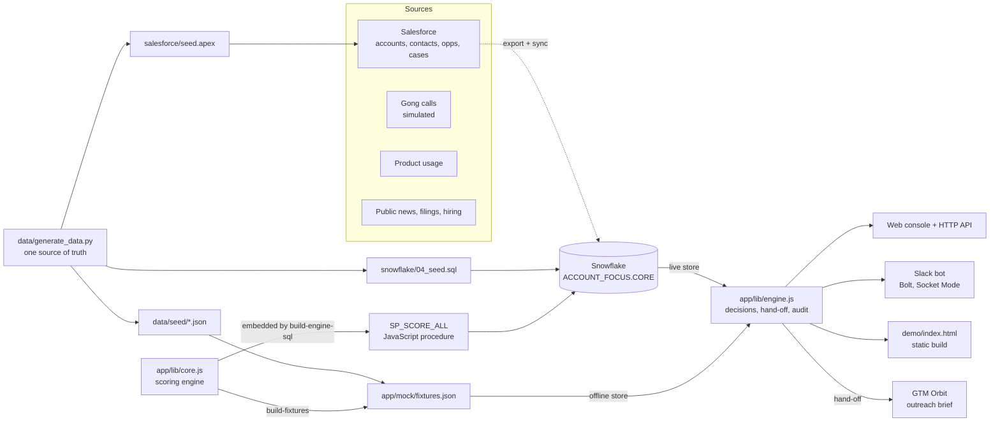
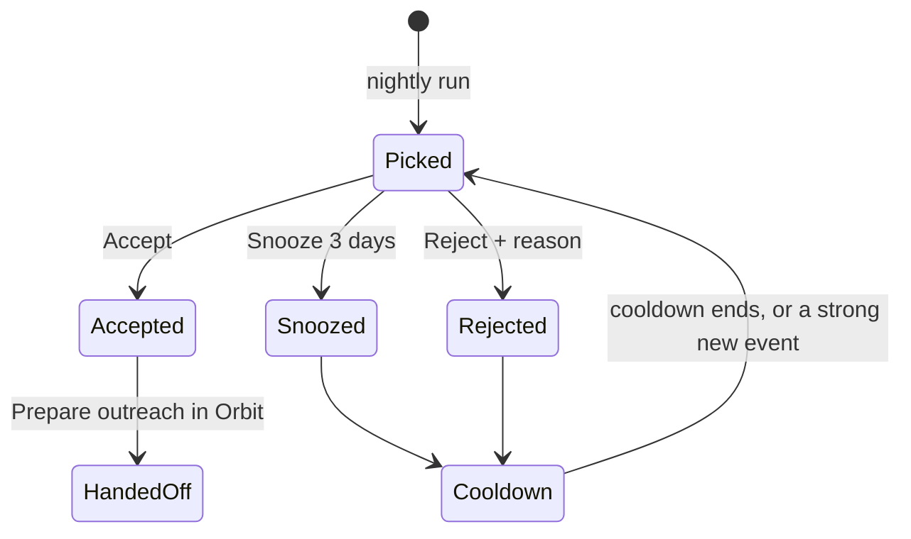

# Architecture

How the pieces fit. For the reasoning behind the scoring see [DESIGN.md](DESIGN.md).

## Components



| Component | File | Job |
| --- | --- | --- |
| Data generator | `data/generate_data.py` | Writes every seed file from one script, so the fictional world is consistent and regenerable |
| Scoring engine | `app/lib/core.js` | Pure JavaScript. Signals → events → four scores → action → brief → validated wording → audit events. Runs in Node and inside Snowflake |
| Snowflake procedure | `snowflake/05_engine.sql` | Generated from `core.js`. `CALL SP_SCORE_ALL('scripted' \| 'cortex')` writes one run to `AF_RUN` |
| App engine | `app/lib/engine.js` | Rules on top of a run: one decision per pick per day, fixed reject reasons, hand-off, audit. Runs in Node and the browser |
| Stores | `app/lib/engine.js` (memory), `app/lib/store-snowflake.js` (live) | Same interface: `getRun`, `listFeedback`, `addFeedback`, `listAudit`, `addAudit`, `addHandoff` |
| Server | `app/server.js` | Express console + API, optional Slack bot, clean shutdown |
| Slack | `app/lib/slack.js`, `app/lib/slack-blocks.js` | `/focus` command, buttons, reject modal |
| Static demo | `app/scripts/build-demo.js` → `demo/index.html` | The real console with fixtures inlined; no server |

**Why one engine in two runtimes?** Offline mode, the tests and Snowflake run the same file, so the numbers cannot drift. `test/engine.test.js` runs the generated procedure body against a fake `snowflake` object and checks it produces exactly the offline brief.

## Data model (Snowflake, `ACCOUNT_FOCUS.CORE`)

| Table | Grain | Notes |
| --- | --- | --- |
| `AF_ACCOUNT` | Account | `DATA` holds key, Salesforce ID, firmographics, motion, baseline score, fit inputs |
| `AF_SIGNAL` | Evidence item | `DATA` holds ref, side (inside/outside), source, family, type, date, strength, polarity, speaker, speaker side, matched flag, event key |
| `AF_CONTACT` | Contact | Role hypothesis, last engaged date, opted-out and do-not-call flags |
| `AF_DRAFT` | Account | Scripted wording (why now sentences with refs, action) |
| `AF_PREP` | Account | Exec prep source lines with refs and public/internal tags |
| `AF_VALUEMAP`, `AF_CATALOG` | — | Priority → value proposition → proof point |
| `AF_CONFIG` | Key | `demo_today` pins the date; `model`; brief size, caps and cooldowns |
| `AF_SEGMENT`, `AF_BACKTEST` | — | Evaluation inputs (synthetic) |
| `AF_RUN` | Run | The whole run as JSON: the app reads the latest |
| `AF_SCORE` | Run × account | Flat scores for SQL and dashboards |
| `AF_FEEDBACK` | Decision | accepted / snoozed / rejected, reason, actor, day |
| `AF_HANDOFF` | Hand-off | Payload for GTM Orbit's outreach brief |
| `AF_AUDIT` | Event | Every run step and human decision |

Views: `V_SIGNAL` (typed signals), `V_LATEST_SCORE`, `V_BRIEF` (today's five with decisions), `V_FEEDBACK_SUMMARY`.

## Evidence IDs

| Pattern | Source | Example |
| --- | --- | --- |
| `GONG-<call>#<moment>` | Call moment | `GONG-9120#4` |
| `SF-OPP-<id>`, `SF-CASE-<n>`, `SF-CTR-<n>`, `SF-ACC-<id>`, `SF-CON-<id>` | Salesforce record | `SF-OPP-006ORB000000031AAA` |
| `PUB-ER-…`, `PUB-NEWS-…`, `PUB-LTR-…`, `PUB-JOBS-…` | Public source | `PUB-ER-0024-Q3` |
| `USAGE-<acct>-<metric>` | Product usage | `USAGE-0019-SEATS` |
| `INTENT-<acct>-<topic>` | Third-party intent | `INTENT-0024-TECH_SCHEDULING` |

GTM Orbit uses the same `GONG-` and `SF-` patterns, so a hand-off carries IDs Orbit already understands.

## The run (shape of `AF_RUN.PAYLOAD` and `app/mock/fixtures.json`)

```json
{
  "version": "af_v1.0", "as_of": "2026-11-09", "model": "scripted",
  "brief": { "picks": ["GTM-0024", "GTM-0011", "GTM-0012", "GTM-0001", "GTM-0002"], "rest": ["GTM-0019", "..."] },
  "accounts": { "GTM-0024": {
    "scores": { "A": 85, "M": 91, "R": 88, "C": 92, "P": 88 },
    "action": { "kind": "Pursue", "title": "Request an executive meeting with Dana Whitfield", "points": ["..."] },
    "why": { "text": "...", "refs": ["GONG-9120#4", "PUB-ER-0024-Q3"], "removed": [{ "text": "...", "reason": "no evidence ID" }] },
    "signals": [], "events": [], "roles": {}, "gaps": [], "valuemap": [], "prep": {}, "slot": "ranked", "pipeline": {} } },
  "stats": { "signals_read": 61, "counted": 57, "not_counted": 1, "context": 3, "removed": 1 },
  "evaluation": { "backtest": {}, "extraction": {}, "groundedness": {} },
  "audit": [{ "at": "2026-11-09T06:02:31Z", "actor": "validator", "event": "CLAIM_REMOVED", "detail": "..." }]
}
```

## Pick states



One decision per pick per day (a second attempt returns 409). Only today's five can be decided.

## HTTP API

| Method | Path | Returns |
| --- | --- | --- |
| GET | `/api/health` | Mode, demo date, configuration problems |
| GET | `/api/brief` | Today's five, the rest of the book, stats |
| GET | `/api/accounts/:key` | One account (key, or a unique part of the name) |
| GET | `/api/accounts/:key/prep` | Exec prep, or 404 |
| POST | `/api/accounts/:key/decision` | `{ "decision": "accepted" \| "snoozed" \| "rejected", "reason"?: "..." }` |
| POST | `/api/accounts/:key/handoff` | The hand-off payload for GTM Orbit |
| GET | `/api/audit` | Latest audit events |
| GET | `/api/evaluation` | Backtest, extraction and groundedness numbers |
| GET | `/api/reasons` | The fixed reject reasons |
| POST | `/api/reset` | Offline only: clear decisions |

## Event catalog

| Event | Actor | When |
| --- | --- | --- |
| `FOCUS_SCORE_RUN` | scheduler | A run starts |
| `SIGNALS_READ` | extractor | Signals counted and ignored |
| `EVENTS_CLUSTERED` | extractor | Signals grouped into events |
| `CLAIM_REMOVED` (WARN) | validator | A sentence had no valid evidence |
| `MODEL_FALLBACK` (WARN) | focus | Cortex failed; scripted wording used |
| `BRIEF_BUILT` | focus | Five picks chosen |
| `BRIEF_DM_SENT` | slack | `npm run send-brief` posted the brief |
| `PICK_ACCEPTED` / `PICK_SNOOZED` / `PICK_REJECTED` (HUMAN) | seller | A decision in the console or Slack |
| `HANDOFF_TO_ORBIT` | seller | Prepare outreach |
| `ORBIT_RUN_STARTED` / `ORBIT_NOT_REACHED` | system | Result of calling GTM Orbit |

## Security model

- The app logs in to Snowflake as `ACCOUNT_FOCUS_SVC`, a `TYPE = SERVICE` user with key-pair auth and no password. Its role can read runs and write decisions, hand-offs and audit events, nothing else.
- The private key lives in `app/.keys/` (git-ignored). Tokens live in `app/.env` (git-ignored).
- The server binds to 127.0.0.1 unless `FOCUS_HOST` says otherwise. Slack uses Socket Mode, so no public URL is needed.
- `FOCUS_SELLER_SLACK_IDS` limits who can decide on picks in Slack.
- Opted-out and do-not-call contacts are never suggested.
- Everything in this repo is fictional; emails use `.example`.

## Design decisions

| Decision | Why |
| --- | --- |
| The run is one JSON document | The app, Slack and the demo need the same nested shape; `AF_SCORE` gives SQL users a flat view |
| JavaScript procedure, not SQL scoring | Keeps one engine for offline, tests and Snowflake |
| Scripted wording by default | Snowflake trials block AI functions; the validator runs either way |
| Pinned demo date | The demo looks the same every day |
| Hand-off saves a record, then calls Orbit's existing `POST /api/runs` | Orbit's code stays unchanged; if Orbit is down the record is kept and the seller is told |
