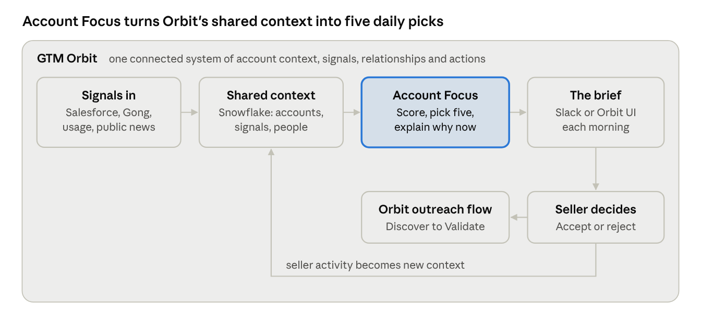
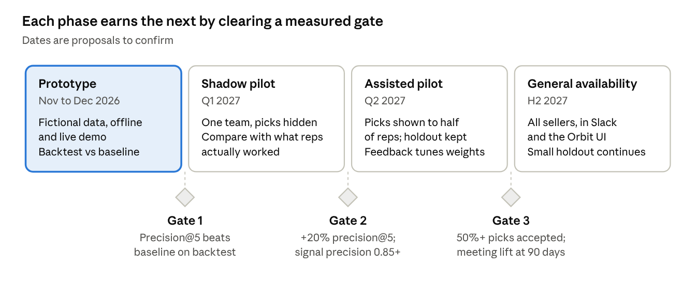

# Account Focus · PRD

Status: prototype on fictional data · last updated 9 Nov 2026 · living version: [Claude doc](https://claude.ai/artifact/1tzZQv2wtgvWi75zDoV54E)

## Summary

**Account Focus is the daily decision layer inside GTM Orbit.** It turns Orbit's shared account signals into focused seller action. Each morning it brings forward the five account-and-motion combinations most worth a seller's attention, explains why now, names who to engage, and recommends what to say and do next. Each recommendation links back to its evidence, and seller activity feeds new context into the orbit.

| | |
| --- | --- |
| **For** | Account executives and account managers who own 30–150 accounts and can actively work 10–15 |
| **Where** | A **Focus** view in the Orbit web console, and a daily brief in Slack |
| **Stack** | Salesforce (system of record) · Gong (calls, simulated) · Snowflake (data, scoring, Cortex) · Slack · Node.js |
| **Status** | Working prototype on fictional data (this repo) |

**The bet:** sellers act on a short list they can check. If every pick shows *why now*, *who is missing* and *the evidence*, sellers will accept at least half of them, and those accounts will convert to meetings measurably more often than a holdout group picked the old way.

GTM Orbit is the connected system of account context, signals, relationships and actions. Account Focus is the seller's daily view into it. The brief is how Account Focus delivers its picks, in Slack or the UI. Its **Prepare outreach** button hands an account to Orbit's existing Discover → Research → Compose → Validate flow.

## Problem

Sellers gain time from AI but don't spend it on the accounts that matter, and the ranked lists they get can't tell them why now or whether they can reach the people who decide.

| Evidence | Number | Source |
| --- | --- | --- |
| Time AI saves sellers each week | 4.8 hours | [Gartner, 19 May 2026](https://www.gartner.com/en/newsroom/press-releases/2026-05-19-gartner-survey-finds-ai-saves-sellers-nearly-five-hours-per-week-yet-seventy-two-percent-of-sales-organizations-fail-to-reinvest-time-in-high-value-activities) (210 sales leaders, Jan–Feb 2026) |
| Sales organizations that don't reinvest that time in high-value activities | 72% | Same |
| Growth likelihood when sellers get AI-enabled next best actions | 2.6× | [Gartner, 20 May 2026](https://www.gartner.com/en/newsroom/press-releases/2026-05-20-gartner-survey-finds-sales-organizations-that-provide-ai-enabled-next-best-actions-are-two-point-six-times-more-likely-to-achieve-commercial-growth) (227 CSOs, Aug–Sep 2025) |
| People who influence a B2B purchase | 13 internal + 9 external | [Forrester, State of Business Buying 2026](https://digitalcommerce360.com/2026/01/22/forrester-b2b-buying-ai-2026/) |
| Buyers who prefer to validate AI-generated insights with a sales rep | 69% | [Gartner, 20 May 2026](https://www.businesswire.com/news/home/20260520585188/en/Gartner-Survey-Finds-69-of-B2B-Buyers-Turn-to-Sales-Reps-to-Validate-AI) (645 buyers, Aug–Sep 2025) |

**Root causes**

1. **One blended score hides the decision.** A propensity score mixes "worth winning" with "moving now" and says nothing about whether the seller can reach the economic buyer.
2. **Signals are counted, not read.** Gong tracker hits fire on a rep's question as readily as on a CFO's commitment, so call volume masquerades as intent.
3. **Outside and inside never meet.** What the company says publicly sits apart from what it has told us on calls and what we sell.
4. **No proof loop.** Recommendations ship without a holdout, so nobody knows whether the ranking or the persuasive explanation drove results.

## Goals and non-goals

**Goals**

1. A daily brief of at most five account × motion picks per seller, each with a one-line why now, a readiness check and one next action.
2. Four separate numbers (Attractiveness, Momentum, Readiness, Confidence), so a hot account with the wrong people routes to *multithread*, not to the bottom of the list.
3. Speaker-attributed, typed buying signals from calls, with a quote and timestamp.
4. Outside-in context joined to inside context, with contradictions surfaced.
5. Cited exec prep for any account × executive, every line tagged public or internal.
6. Proof: precision@5 against a baseline offline, and meeting lift against a holdout online.
7. Native to GTM Orbit: same shell, same evidence IDs, hand-off to Orbit's brief flow.

**Non-goals for v1:** writing or sending outreach (Orbit does this, with human approval); territory design, quota setting or forecasting; buying third-party intent data; replacing an existing scoring model (Account Focus reads a baseline score and adds dimensions around it).

## Users and personas

| Persona | Job to be done | Needs | Where they work |
| --- | --- | --- | --- |
| Account executive (primary) | Decide which accounts to work today and what to do | Five picks, why now, who's missing, a next step they can take in minutes | Slack in the morning, Orbit console during the day |
| Account manager | Grow and protect existing customers | Expansion and renewal-risk signals, champion changes | Slack, Salesforce |
| Front-line sales manager | Coach reps on where they spend time | Team view of picks, acceptance, reject reasons | Orbit console, weekly 1:1s |
| Executive sponsor (VP, CRO) | Walk into an exec meeting prepared | Point of view, the customer's stated priorities, landmines | Exec prep one-pager |
| RevOps / sales analytics | Trust and tune the model | Score breakdown, feedback, holdout results, data-quality flags | Evaluation view, Snowflake |

## User stories and demo records

1. As an AE, I open Slack at 8am and see my five picks, each with why now and one action, so I can plan my day in two minutes.
2. As an AE, I open a pick and see the four scores, the signals behind them (each linked to its source) and which buying roles are missing.
3. As an AE, I accept, snooze or reject a pick with a one-tap reason; rejected accounts stay out for 14 days unless something big happens.
4. As an AE, I press **Prepare outreach** and the account goes to Orbit's brief flow with Focus's context attached.
5. As an executive sponsor, I open exec prep and get a point of view, their priorities in their own words, questions, proof and landmines, each tagged public or internal.
6. As a manager, I see my team's picks, acceptance and reject reasons, so I can coach.
7. As RevOps, I see precision@5 versus the baseline and meeting lift versus a holdout.

**Demo records.** Ten of GTM Orbit's 25 fictional accounts, owned by the fictional AE Alex Rivera at Acme. Demo "today" is pinned to 9 Nov 2026. Ranks below are what the engine in this repo produces.

| Account | Motion | What it proves | Focus outcome |
| --- | --- | --- | --- |
| Keystone Elevator Services | New logo | **Hero run.** New CFO and a 12% cost program (public); CFO says budget is set aside for Q1 (call). | Rank 1 · Pursue · exec prep · validator removes one uncited claim |
| Pacific Crest Home Services | New logo | **Contradiction.** CEO is consolidating vendors; our open opportunity is an add-on. | Rank 2 · Pursue · narrative-mismatch gap |
| Meridian Senior Living | Renewal risk | **Rescue.** Champion silent 47 days, usage down 31%, renewal in 84 days. | Rank 3 · Rescue |
| Northstar Field Services | Expansion | **Hot account, wrong people.** Strong signals, no economic buyer or technical evaluator. | Rank 4 · Multithread |
| Juniper Ridge Health | Expansion | **Exploration slot + new exec.** New CIO 38 days ago, nobody has met her. | Exploration slot · Multithread |
| Heartland Foodservice | Expansion | **Usage signal.** Seats at 96%. | Held: five slots full |
| Copperline Fiber Services | New logo | **Tracker trap.** 9 budget and pricing tracker hits, all spoken by our rep. | Momentum 0 · watching |
| Cobalt Ledger Systems | Expansion | **Stale data.** Score 6 days old; call speaker not matched to a contact. | Verify · confidence 41 |
| Quarry & Pine Manufacturing | New logo | **Unknown is not low.** No baseline, no calls. | Not scored |
| Kestrel Biotech | New logo | **Deprioritize, said out loud.** Outside the ICP. | Deprioritized |

## Functional requirements

| ID | Requirement | Priority | Prototype status |
| --- | --- | --- | --- |
| FR-01 | Compute Attractiveness, Momentum, Readiness and Confidence (0–100) per account × motion, from point-in-time inputs | P0 | Built |
| FR-02 | Priority = √(Attractiveness × Momentum); Readiness and Confidence route the action, never the rank | P0 | Built |
| FR-03 | Brief of at most 5 picks per seller: ≤ 3 per motion, 1 exploration slot, 14-day cooldown after a rejection | P0 | Built |
| FR-04 | Cluster signals into events with a corroboration count; per-family weight and half-life | P0 | Built |
| FR-05 | Two-stage call signals: tracker hit, then a read of speaker and meaning; rep-spoken hits don't count | P0 | Built (scripted offline; Cortex in live mode) |
| FR-06 | Readiness from required buying roles and engagement in the last 60 days | P0 | Built |
| FR-07 | Detect gaps: narrative mismatch, new exec with no relationship, single-threaded, champion risk, stalled commitment or next step, unverified identity | P0 | Built |
| FR-08 | One next best action from a fixed catalog, filtered by deterministic rules | P0 | Built |
| FR-09 | Cited why now; uncited claims are removed by the validator | P0 | Built |
| FR-10 | Exec prep with point of view, priorities, questions, proof, landmines and ask, each line tagged public or internal | P0 | Built for 3 accounts |
| FR-11 | Focus view in an Orbit-style console: brief, account page, exec prep, evaluation | P0 | Built |
| FR-12 | Slack `/focus`, `/focus <account>`, `/focus prep <account>`, with Accept, Snooze, Reject buttons | P0 | Built |
| FR-13 | Feedback with fixed reject reasons; an audit event for every score, pick and decision | P0 | Built |
| FR-14 | "Prepare outreach" hands the account and its context to GTM Orbit | P1 | Built (hand-off record; Orbit reads it when wired in) |
| FR-15 | Offline backtest: precision@5 and top-decile lift versus the baseline | P1 | Built (synthetic history) |
| FR-16 | Daily 8am Slack brief | P1 | Built (`npm run send-brief`) |
| FR-17 | Manager team view | P2 | Not started |
| FR-18 | Fit weights from outcomes with a regularized logistic model | P2 | Not started |

## Trust, guardrail and non-functional requirements

| ID | Requirement |
| --- | --- |
| TR-01 | Every sentence in a why now or exec prep cites an evidence ID that exists for the account; the validator removes anything else |
| TR-02 | Numbers are deterministic; a model may write the explanation but never sets a score |
| TR-03 | Missing or stale inputs lower Confidence and show as unknown or stale, never as a low score |
| TR-04 | Exec prep lines are tagged public or internal |
| TR-05 | Focus recommends; the seller decides. Nothing is sent from Focus |
| TR-06 | The app logs in as a key-pair service user with a least-privilege role |
| TR-07 | Opted-out and do-not-contact people are never suggested |
| TR-08 | Every score run, pick, removed claim, decision and hand-off is an audit event |
| TR-09 | Runs are append-only and keyed by date and version, so any past pick can be replayed |
| NFR-01 | Brief loads in under 2 s; offline mode runs with no accounts |

## Solution overview

| Stage | Reads | Produces | Guardrail |
| --- | --- | --- | --- |
| Signals | Salesforce, Gong, usage, public news and filings | Typed, speaker-attributed signals clustered into events | Rep-spoken hits don't count |
| Score | Inputs in Snowflake | Attractiveness, Momentum, Readiness, Confidence | Deterministic |
| Pick | Scores, cooldowns, motion caps | Five picks, one exploration slot | ≤ 3 per motion; 14-day cooldown |
| Explain | Events, gaps, seller catalog | Why now, exec prep, next best action | Validator removes uncited claims |
| Act | Seller decision | Feedback, hand-off to Orbit | Nothing is sent without approval |

Scoring math, signal taxonomy and data model: [DESIGN.md](DESIGN.md) and [ARCHITECTURE.md](ARCHITECTURE.md).

## Success metrics

**North star: meetings booked with a required buying role from Focus picks, per seller per week.** All targets are proposals to confirm in the shadow pilot.

| Type | Metric | Pilot target (proposal) |
| --- | --- | --- |
| North star | Buying-role meetings from Focus picks per seller per week | +30% vs holdout at 90 days |
| Adoption | Sellers who open the brief on 4 of 5 workdays | ≥ 70% |
| Adoption | Pick acceptance rate | ≥ 50% |
| Quality | Precision@5 vs baseline score | ≥ 20% relative lift |
| Quality | Top-decile lift | ≥ 3× |
| Quality | Call signal precision; speaker attribution | ≥ 0.85; ≥ 0.95 |
| Trust | Claims with a valid supporting citation | ≥ 98%, zero uncited numbers |
| Trust | Picks rejected as "bad data" | < 10% |
| Guardrail | Suggested contacts who opted out | 0 |

## Competitive landscape

Everyone now ranks accounts. Nobody publicly combines buying-group readiness, a public-vs-private value map for exec prep, and proof against a holdout in one daily view. "Not described" means the vendor's public material is silent.

| Vendor | Daily ranked list | Why now | Buying-group readiness | Exec prep and value mapping | Measured against a holdout |
| --- | --- | --- | --- | --- | --- |
| [Salesforce Prospecting Agent](https://www.salesforce.com/sales/prospecting/agent/) | Yes, "based on intent, activity, and fit" | Compelling events | Not described | Not described | Not described |
| [Microsoft Dynamics 365 Sales](https://mc.merill.net/message/MC1310377) | Leads, not accounts | "Why a lead matters" | Not described | Not described | Not described |
| [Gong Mission Andromeda](https://www.gong.io/de/platform/mission-andromeda) | Account boards | Activity and risk | Not described | Account handover brief | Not described |
| [Clari](https://www.businesswire.com/news/home/20250519401403/en/Clari-Unveils-Industry-First-Offering-AI-Agents-Powered-by-Revenue-Context) | Tasks, not accounts | Deal-level | Not described | Not described | Not described |
| [6sense](https://www.destinationcrm.com/Articles/CRM-News/CRM-Across-the-Wire/6sense-Brings-Intelligence-Directly-into-AI-Agents-and-Entire-GTM-Stack-176086.aspx) | Buying stages, via MCP | Intent | Not described | Not described | Not described |
| [Demandbase Agentbase](https://press.aboutamazon.com/aws/2025/5/demandbase-announces-agentbase-as-the-first-gtm-ai-agents-built-on-aws) | Not described | Intent and account summaries | Buying-group completeness | Not described | Not described |
| [Common Room](https://www.commonroom.io/compare/usergems/) | Shared queue with scoring | First- and third-party signals | Not described | Research agent | Not described |

## Rollout plan

A failed gate repeats its phase with tuned weights rather than moving forward.

## Risks, dependencies, open questions

| Risk | Mitigation |
| --- | --- |
| Tracker false positives inflate momentum | Two-stage reading; rep-spoken hits don't count |
| One event counted three times | Event clustering with a corroboration count |
| Large accounts always win | Attractiveness normalized within segment (P1) |
| Persuasive explanation of a bad ranking | Holdout and precision@5 measured separately from acceptance |
| Model learns only from its own picks | Exploration slot |
| Cortex blocked on a Snowflake trial | Scripted wording, with a MODEL switch to Cortex |
| Real employer data in a portfolio project | Fictional data only |

Open questions: expansion or new logo first; exec prep for every pick or on demand; score at parent or subsidiary; should managers pin accounts; confirm pilot targets.

## Sources

- [Gartner: AI saves sellers nearly five hours per week (19 May 2026)](https://www.gartner.com/en/newsroom/press-releases/2026-05-19-gartner-survey-finds-ai-saves-sellers-nearly-five-hours-per-week-yet-seventy-two-percent-of-sales-organizations-fail-to-reinvest-time-in-high-value-activities)
- [Gartner: AI-enabled next best actions 2.6x more likely to achieve growth (20 May 2026)](https://www.gartner.com/en/newsroom/press-releases/2026-05-20-gartner-survey-finds-sales-organizations-that-provide-ai-enabled-next-best-actions-are-two-point-six-times-more-likely-to-achieve-commercial-growth)
- [Gartner: 69% of B2B buyers turn to sales reps to validate AI (20 May 2026)](https://www.businesswire.com/news/home/20260520585188/en/Gartner-Survey-Finds-69-of-B2B-Buyers-Turn-to-Sales-Reps-to-Validate-AI)
- [Digital Commerce 360 on Forrester's State of Business Buying 2026](https://digitalcommerce360.com/2026/01/22/forrester-b2b-buying-ai-2026/)
- Vendor pages linked in the competitive landscape table
